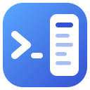

<p align="center"></p>

# CheatDock

A cheat sheet that lives on the edge of your screen.

[Download for Windows](https://github.com/samleointeractive/CheatDock/releases/latest/download/CheatDock-windows.zip) · [Download for Linux](https://github.com/samleointeractive/CheatDock/releases/latest/download/CheatDock-linux.tar.gz) · [Website](https://samleointeractive.com/cheatdock/) · [☕ Support on Ko-fi](https://ko-fi.com/samleointeractive)

CheatDock stays out of the way as a small `>_` icon on the edge of your monitor. Rest the mouse on it, click it, or press **Ctrl+Alt+Space** from any app, and it slides open with the cheat sheets **you** picked. Click a command to copy it, then go back to work.

## Features

- **Pick your cheat sheets**: on first launch a setup screen lets you choose from a library of **18 cheat sheets (550 commands)** and set the tab order. Change it any time with the ⚙ button
- **★ Favorites**: star the commands you use most and they appear together in the first tab. Commands you copy often also show up there under **Most used**
- **A small icon docked to the screen edge**, always on top, never in your taskbar
- **Works with multiple monitors**: drag the icon, or the panel's title bar, to any side of any screen. It snaps to the nearest edge and remembers where you left it
- **Opens on hover, click or a global hotkey**, and closes when you move away or press `Esc`
- **Databricks in two columns**: every task shows the PySpark and the SQL version side by side, and the panel widens while that tab is open
- **Search across every tab at once.** Each tab shows how many matches it has, and `Enter` copies the first result
- **Click to copy** any command. When a card shows several commands, click one line to copy just that command, or **Copy all** (or the title) for the whole card
- **Pin** the panel open while you work through something
- **Plain YAML files**: add a tab or a command by editing a text file, and the app reloads on its own
- **Light and dark themes**: the ☀ / ☾ button in the panel switches them, and your choice is remembered
- **Windows and Linux**, system tray icon, no admin rights needed

## Quick start

### Windows
Grab `CheatDock-windows.zip` from the [Releases](../../releases) page, unzip it anywhere and run `CheatDock.exe`.

To start it with Windows, press `Win+R`, type `shell:startup` and put a shortcut to `CheatDock.exe` in that folder.

### Linux
Grab `CheatDock-linux.tar.gz` from the [Releases](../../releases) page, then:

```bash
tar -xzf CheatDock-linux.tar.gz
cd CheatDock
./install.sh      # adds CheatDock to your app menu, optionally starts it at login
./CheatDock
```

- **Hotkey:** Linux has no standard way for an app to grab a global hotkey, so add a keyboard shortcut in your desktop settings that runs `/path/to/CheatDock/CheatDock --toggle` (GNOME: Settings › Keyboard › Custom Shortcuts; KDE: System Settings › Shortcuts).
- **Wayland:** Wayland doesn't let apps place their own windows, so CheatDock runs through XWayland (on by default in GNOME, KDE and most desktops) to dock to the screen edge.
- **Missing libraries:** if it doesn't start on Debian or Ubuntu, install Qt's X11 libraries: `sudo apt install libxcb-cursor0 libxkbcommon-x11-0`.
- **Tray icon:** GNOME needs the AppIndicator extension to show tray icons; everything else works without it.

### Run from source
Requires Python 3.10+.

```bash
git clone https://github.com/samleointeractive/CheatDock.git
cd CheatDock
python -m venv .venv
.venv\Scripts\activate          # Linux: source .venv/bin/activate
pip install -r requirements.txt
python -m cheatdock
```

On Windows, double-click `run_cheatdock.pyw` to start it without a console window.

### Command line
`CheatDock --toggle`, `--show` and `--hide` control the CheatDock that is already running, which is handy for keyboard shortcuts and scripts. Starting CheatDock again while it runs opens the panel.

## Cheat sheet library

| Category | Cheat sheets |
|---|---|
| Shell & OS | PowerShell, Bash / Linux, CMD, Windows shortcuts |
| Data | SQL, Pandas, NumPy, Databricks, Excel, Power BI DAX, R |
| Programming | Python, JavaScript, Regex |
| Tools | Git, Docker, VS Code, Jupyter & envs |

## Keyboard shortcuts

| Keys | Action |
|---|---|
| `Ctrl+Alt+Space` | Show / hide from anywhere (configurable) |
| `Ctrl+F` | Focus search |
| `Enter` (in search) | Copy the first match |
| `Ctrl+1` … `Ctrl+9` | Switch tab |
| `Ctrl+P` | Pin / unpin |
| `Ctrl+,` or ⚙ | Choose cheat sheets |
| `Ctrl+T` | Switch light / dark theme |
| `Ctrl+Q` or ✕ | Close CheatDock |
| `F5` | Reload cheat sheets |
| `Esc` or – | Clear search, then hide |

## Adding your own commands

Every file in [`cheatsheets/`](cheatsheets) appears in the setup library, and the app reloads as soon as you save one. To add a new one, for example Kubernetes, create `cheatsheets/19-kubernetes.yaml`, then tick it with the ⚙ button:

```yaml
name: Kubernetes          # tab title
order: 19                 # position in the library
category: Tools           # group in the setup screen
description: Pods, deployments and logs with kubectl.
sections:
  - name: Basics
    items:
      - title: List pods
        code: |-
          kubectl get pods -A
        note: Optional one-line explanation.
```

Use `code: |-` followed by an indented block. That way you never have to escape quotes, colons or `#`.

To show two versions side by side, list the columns at the top of the file and give each item one key per column (see [`18-databricks.yaml`](cheatsheets/18-databricks.yaml)):

```yaml
columns:
  pyspark: PySpark
  sql: SQL
sections:
  - name: Read
    items:
      - title: Read a table
        pyspark: |-
          df = spark.table("main.sales.orders")
        sql: |-
          SELECT * FROM main.sales.orders;
```

## Settings

Edit [`config.yaml`](config.yaml) and restart the app:

```yaml
theme: dark               # dark | light | system
edge: right               # starting side before you drag it
width: 440
wide_width: 760           # tabs with side-by-side columns (Databricks)
icon_size: 40
icon_position: 0.5        # starting height: 0 top, 1 bottom
expand_on_hover: true
hover_delay_ms: 250
collapse_delay_ms: 500
hotkey: ctrl+alt+space    # e.g. ctrl+shift+k, win+alt+c, f9 ("" to disable)
opacity: 0.97
```

The position you drag it to (screen, side and height), your theme, chosen cheat sheets, favorites and copy counts are saved in `%LOCALAPPDATA%\CheatDock\state.json`. The tray menu also has **Move to next screen**.

## Building it yourself

On Windows, run `.\build.ps1`. It creates `dist\CheatDock\CheatDock.exe` with `config.yaml` and `cheatsheets\` next to it (so they stay editable), plus `dist\CheatDock-windows.zip`.

On Linux, run `./build.sh`. It creates `dist/CheatDock/CheatDock` and `dist/CheatDock-linux.tar.gz`.

Pushing a tag such as `v1.0.0` makes GitHub Actions build both and publish them as a Release automatically (see `.github/workflows/release.yml`).

## Contributing

Pull requests that add useful commands or new cheat sheets are welcome. Keep each item short: one task, one snippet.

## Support

CheatDock is free and always will be. If it saves you time, you can buy me a coffee:

[](https://ko-fi.com/samleointeractive)

You'll also find the ☕ button in the panel and in the tray menu. More projects at [samleointeractive.com](https://samleointeractive.com).

## License

[MIT](LICENSE)
